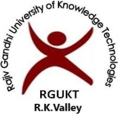

# 🏛️ Smart College Event Management System (Smart CEMS)
### Rajiv Gandhi University of Knowledge Technologies (RGUKT) - IIIT RK Valley
**Software Engineering Laboratory Project (CSE - E3 S1)**

<p align="center">
  
  
</p>

---

## 🚀 Overview

The **Smart College Event Management System (Smart CEMS)** is an end-to-end, multi-tier software system engineered specifically for **RGUKT IIIT RK Valley, Idupulapaya, Andhra Pradesh**. Built with a clean, trending UI and modern software engineering principles, it covers the entire lifecycle of university festivals, hackathons, sports tournaments, and workshops.

---

## 🛠️ Complete Multi-Technology Stack

| Component | Technology | Description |
|---|---|---|
| **Frontend** | **React 18 + Vite** | Clean component architecture, Tailwind CSS, Lucide React icons, and QR generation |
| **Backend API** | **Node.js + Express** | REST API endpoints for authentication, events, registrations, and gate verification |
| **Database** | **SQL & Supabase** | Relational SQL schema (`schema.sql`), 3NF normalized tables, and Supabase client SDK integration |
| **AI Microservice** | **Python 3** | Content-based NLP event recommendations and SHA-256 cryptographic certificate verification |

---

## 🌟 Key Features

1. **Official RGUKT College Logo & Campus Scenery:**
   - Features the authentic circular RGUKT RK Valley emblem and the scenic Idupulapaya cliff backdrop on the Hero & Venues sections.
2. **Dynamic Role-Based Access Control:**
   - Real, dynamic user registration with role selection: **Student**, **Event Coordinator**, or **Dean Admin**.
   - No hardcoded static names. Any student or faculty can register with their own credentials.
3. **Dynamic Coordinators per Event:**
   - In university campus life, event leads change per event.
   - Organizers can dynamically assign coordinator names, phone numbers, emails, and faculty advisors for each specific event.
4. **Digital QR E-Ticket & Gate Attendance Scanner:**
   - Scannable 2D QR Code passes with printable formatting.
   - Real-time verification simulator that detects and blocks duplicate check-in attempts.
5. **Python AI Event Recommender:**
   - Students receive personalized event matches based on their branch and domain interests via the Python AI microservice.
6. **Campus Venue Collision & Conflict Guard:**
   - Algorithmically cross-checks all bookings at the Student Activity Center (SAC), Open Air Theatre (OAT), and Computer Labs to prevent scheduling clashes.
7. **Automated Participation Certificate Generator:**
   - HTML5 Canvas dynamic certificate generator featuring the university crest, coordinator, and Dean signatures with PNG download.

---

## 📂 Project Directory Structure

```
Smart-College-Event-Management-System/
├── frontend/                  # React 18 SPA (Vite + Tailwind CSS + Lucide Icons)
│   ├── src/
│   │   ├── components/        # Navbar, HeroBanner, EventCard, Modals, etc.
│   │   ├── pages/             # Discovery, StudentPortal, OrganizerHub, AdminDashboard, Venues, Notices
│   │   ├── services/          # API Client & Python AI Service connector
│   │   └── assets/            # Official RGUKT emblem (PNG & SVG)
│   └── package.json
├── backend/                   # Node.js + Express REST API
│   ├── server.js              # REST endpoints & static server
│   ├── db.js                  # Relational SQL storage handler & seed loader
│   ├── supabaseClient.js      # Supabase cloud SDK integration
│   └── package.json
├── database/                  # SQL Schema & Migrations
│   ├── schema.sql             # ANSI SQL DDL Table definitions
│   ├── seed.sql               # RGUKT IIIT RK Valley initial datasets
│   └── supabase_setup.sql     # Supabase PostgreSQL RLS policies & triggers
├── python-service/            # Python Microservice (Port 5001)
│   ├── app.py                 # AI Recommender & Cryptographic Hasher
│   └── requirements.txt
├── docs/                      # Complete SE Lab Submission Documentation
│   ├── SRS_Document.md        # IEEE 830 compliant Requirements Specification
│   ├── Architecture_Design.md # Multi-tier Architecture Diagram
│   ├── UML_Diagrams.md        # Use Case, Class, Sequence & ER Diagrams
│   ├── Database_Design.md     # Relational Data Dictionary & 3NF details
│   └── Test_Cases.md          # Comprehensive Testing Document
├── run.sh                     # One-click startup script for all services
└── README.md
```

---

## ⚡ Quick Start Guide

### Start All Services in One Command:
```bash
cd "/home/rgukt/Desktop/E-Content/E3/S1/SE Lab/Smart-College-Event-Management-System"
./run.sh
```

This starts:
* **React Frontend:** `http://localhost:3000`
* **Node.js API Server:** `http://localhost:5000`
* **Python AI Microservice:** `http://localhost:5001`

*(Or run individually via `npm run server`, `npm run python`, or `npm run frontend`).*
