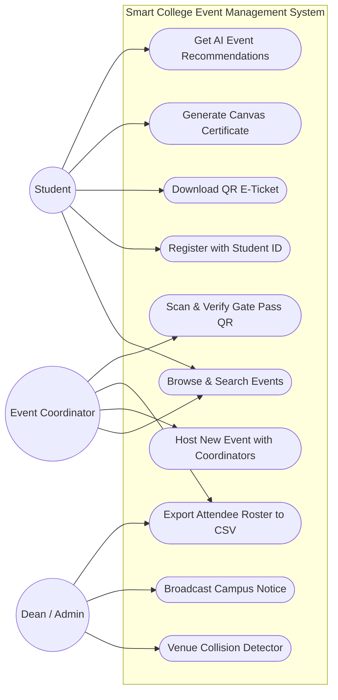
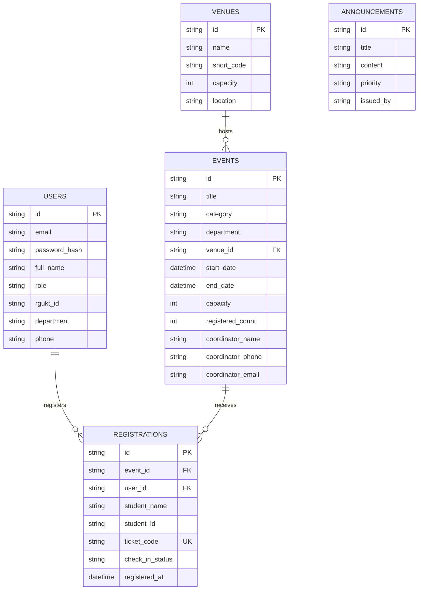
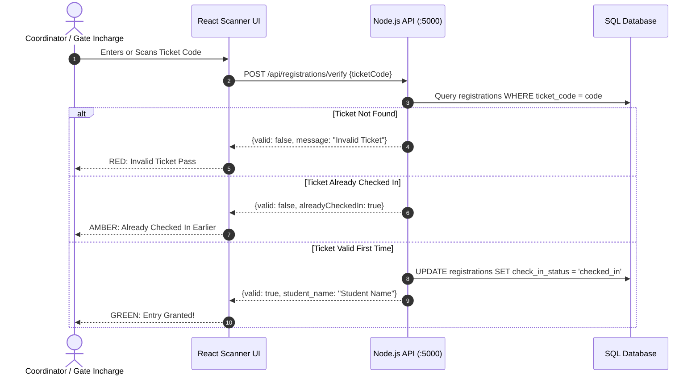

# Software Engineering UML Diagrams
## Smart College Event Management System (Smart CEMS)

### 1. Use Case Diagram

### 2. Entity-Relationship (ER) Diagram

### 3. Sequence Diagram: Event Gate Check-in

